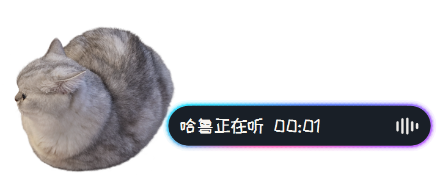

# 哈鲁语音输入 · HaruVoice

**按住说话，松开出字，让小猫哈鲁陪你输入。**

Windows 本地离线语音输入工具，基于 [CapsWriter-Offline](https://github.com/HaujetZhao/CapsWriter-Offline) 定制。集成本地语音识别、可选的本地文字润色、统一热词管理、语音纠错和小猫状态提示。



[下载安装文件](https://github.com/HhangGG/HaruVoice/releases/latest) · [完整使用说明](USAGE.md) · [许可与组件来源](THIRD_PARTY_NOTICES.md)

## 下载与安装

当前版本：**1.2.3 · Windows x64**。模型和运行组件随安装文件提供，无需自己安装 Python。

进入 [Releases 下载页](https://github.com/HhangGG/HaruVoice/releases/tag/v1.2.3)，在 **Assets** 中下载以下 **4 个文件**，全部放在同一文件夹：

```text
HaruVoice-1.2.3-Setup.exe
HaruVoice-1.2.3-Setup-1.bin
HaruVoice-1.2.3-Setup-2.bin
HaruVoice-1.2.3-Setup-3.bin
```

1. 保持文件名不变，确认 4 个文件都已下载完成。
2. 双击 `HaruVoice-1.2.3-Setup.exe`，按中文提示安装。
3. 打开桌面的“哈鲁语音输入”，等待首次模型加载。
4. 点击聊天或文档输入位置，**按住 CapsLock 说话，松开后自动填入文字**。

安装文件合计约 4.36 GiB，安装说明建议预留至少 7 GB 可用空间。只下载 `.exe` 无法安装；GitHub 自动提供的 **Source code (zip/tar.gz)** 也不是安装包。

GitHub 的国内连接速度因网络而异，可能较慢或中断；软件安装完成后的日常识别和润色在本机运行。

## 产品特色

| 功能 | 使用体验 |
| --- | --- |
| 本地离线识别 | 使用本地模型将语音变成文字，不需要云端语音服务或 API 密钥。 |
| GPU 主力与 CPU 备用 | 兼容独显使用 Qwen 主力识别；显存紧张时可自动切到 CPU 低占用模型。 |
| 可选本地润色 | 整理识别结果中的口头语和表达；显存不足时自动释放，满足恢复条件后可自动恢复。 |
| 小猫哈鲁提示 | 录音时有耳朵动作、时长和音量条，处理中显示思考状态，结束后淡出。 |
| 霓虹状态提示 | 润色实际运行时显示流动霓虹，听和思考时有不同的流动速度。 |
| 中日文与屏幕缩放 | 支持中文、日文提示；字体和提示框适应 Windows 显示缩放。 |
| 自定义快捷键 | 默认 CapsLock，也可设置支持的键盘按键、组合键或鼠标侧键；菜单显示当前快捷键。 |
| 鼠标侧键保护 | 程序运行期间拦截两枚侧键的前进、后退，退出后恢复原有用途。 |
| 统一热词系统 | 在大界面集中查看词汇与出现次数，支持搜索、手动新增、自动积累、双击修改和删除。 |
| 语音更正热词 | 说“你打错了”，哈鲁继续听解释，理解后显示“旧词 → 新词”并更新热词。 |
| 上下文与短期记忆 | 可填写工作背景和专名；润色可参考短期口述记忆，也能单独清除。 |
| 数学符号热词 | 预置 25 条公共数学符号词条，在热词界面直接查看、修改和删除。 |
| 状态与资源提示 | 菜单显示显卡、显存和模型名称；麦克风断开、模型加载、润色启停由哈鲁提示。 |
| 自动填入文字 | 将识别结果填入当前输入位置，并保护原有剪贴板内容。 |
| 安装环境适配 | 首次安装按硬件设置默认模式；覆盖安装保留用户已有设置和词库。 |

## 热词纠错怎么说

先按住语音键说：**“你打错了”**，说完松开。

哈鲁进入继续听后，解释正确用字，例如：

> 哈是哈尔滨的哈，鲁是齐鲁大地的鲁。哈鲁。

说完稍停，哈鲁自动处理。理解成功会简要显示类似 **“哈路 → 哈鲁”** 的结果并更新词库；没有听懂则提示并退出，无需再按一次侧键结束。

也可从托盘右键打开“热词系统”，手动新增，双击改错词，或删除不需要的词。热词积累不等于训练声纹，仍可能出现同音词错误。

## 电脑配置与默认模式

| 条件 | 首次安装后的默认选择 |
| --- | --- |
| 8 GB 及以上、驱动和接口兼容的独立显卡 | GPU 主力识别 + GPU 润色，保留显存不足时的自动保护。 |
| 低于 8 GB 的独显、仅核显、没有兼容显卡或无法确认硬件 | CPU 低占用识别，润色关闭。 |

- 基础安装要求：Windows 10 1809 或更新版本 / Windows 11，64 位。
- GPU 模式要求：Windows 10 1903+、DirectX 12、Vulkan 1.2、可用的显存预算查询及厂商驱动。
- NVIDIA / AMD 兼容路径已集成；**本版实际测试覆盖 NVIDIA 和 CPU，尚未完成 AMD 实机测试**。
- 菜单界面在不同硬件上保持一致，也可手动选用模式。手动锁定 CPU 后不会自行切回 GPU。
- 8 GB 显卡的系统预留不影响分档；共享系统内存不作为独显容量计算。

| 用途 | 随包模型 |
| --- | --- |
| 主力语音识别 | Qwen3-ASR-1.7B · Q5_K_M |
| CPU 低占用识别 | SenseVoice-Small |
| 本地文字润色 | Qwen2.5-3B-Instruct · Q4_K_M |

识别和润色速度取决于电脑、驱动、音频长度和当时负载。CPU 备用模式的目的，是在显存不足时继续提供基础语音输入。

## 数据与使用提醒

- 发布安装包不含制作者的个人热词、工作上下文、录音、转写记录或账号密钥，只提供公共默认词条。
- 本地润色的短期记忆最多 3 段、240 字，约 15 分钟；退出后不保留。清除记忆不会删除热词。
- 默认不保存录音文件。程序运行时会保持麦克风连接，待机音频直接丢弃；触发输入或进入纠错继续听时才处理语音。
- 录音时降低播放音量属于可选功能，可能同时降低通话的播放声音。
- 玩游戏需要恢复侧键原用途时，先退出哈鲁。不要同时运行多个安装目录的副本。
- 覆盖安装保留该电脑已有设置和词库；卸载会保留个人配置和词库，便于重新安装恢复。

## 项目来源与许可

感谢 [HaujetZhao/CapsWriter-Offline](https://github.com/HaujetZhao/CapsWriter-Offline) 及各模型、字体和运行库的作者。本项目为定制发行，与原项目保持独立。

原项目 MIT 许可见 [UPSTREAM-LICENSE.txt](UPSTREAM-LICENSE.txt)。各依赖和模型使用各自的许可证，安装目录 `licenses` 中保留完整文本。**随包 Qwen2.5-3B 润色模型采用研究许可，商业使用需遵守模型授权要求**；原项目的 MIT 许可不能替代模型许可。详见 [许可与组件来源](THIRD_PARTY_NOTICES.md)。

发现问题时，请在 [Issues](https://github.com/HhangGG/HaruVoice/issues) 中说明 Windows 版本、显卡、当前模式和复现步骤，提交前检查并去除个人词库、录音、上下文或其他私密信息。
